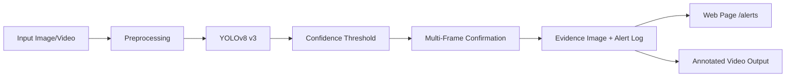

# Weapon Detection API & Frontend

AI-based weapon detection for decision support. **Not proof.**

## Disclaimer

> **AI-generated detection. Not proof that a weapon is present. A human must review every alert.**

This system is a decision-support tool only. It can miss weapons, produce false alarms, and must not be used as the sole basis for security decisions.

## Setup

```bash
# Create and activate virtual environment
python -m venv venv
.\venv\Scripts\activate

# Install dependencies
pip install -r requirements.txt
```

## Run the API

```bash
# Start the FastAPI server (no reload)
.\venv\Scripts\python.exe -m uvicorn api.main:app --host 127.0.0.1 --port 8000
```

- API docs: http://127.0.0.1:8000/docs
- Frontend: http://127.0.0.1:8000/
- Health check: http://127.0.0.1:8000/health

## Run the Video/Webcam Detection (`alert_video.py`)

```bash
# Webcam (default)
.\venv\Scripts\python.exe alert_video.py --source 0

# Video file
.\venv\Scripts\python.exe alert_video.py --source video.mp4

# With custom confidence and alert settings
.\venv\Scripts\python.exe alert_video.py --source video.mp4 --conf 0.35 --window 15 --required 8 --cooldown 5.0 --show
```

Outputs:
- Annotated video: `runs/video/out_<timestamp>.mp4`
- Alert log: `alerts/alert_log.csv`
- Evidence images: `alerts/images/alert_<timestamp>_f<frame>.jpg`

## Run Tests

```bash
.\venv\Scripts\python.exe -m pytest tests/test_api.py -v
```

## Folder Structure

```
weapon-detection/
├── api/
│   ├── __init__.py
│   ├── config.py          # Configuration (model path, thresholds, etc.)
│   ├── schemas.py         # Pydantic models
│   └── main.py            # FastAPI application
├── frontend/
│   └── index.html         # Single-page frontend
├── tests/
│   └── test_api.py        # API tests
├── alerts/
│   ├── alert_log.csv      # Alert log (created by alert_video.py)
│   └── images/            # Evidence images
├── runs/
│   └── detect/v3/weights/best.pt   # YOLOv8s model (1 class: weapon)
├── requirements.txt
└── README.md
```

## API Endpoints

| Method | Endpoint | Description |
|--------|----------|-------------|
| GET | `/health` | Health check (model path, device) |
| POST | `/predict` | Detect weapons in uploaded image |
| GET | `/alerts?limit=20` | Recent alerts from log |
| GET | `/alert-images/<file>` | Static evidence images |
| GET | `/` | Frontend page |

### `/predict` Request

- `file` (multipart): Image (.jpg, .jpeg, .png), max 10 MB
- `conf` (query, optional): Confidence threshold 0.05–0.95 (default 0.35)

### `/predict` Response

```json
{
  "detections": [
    {"box": [x1, y1, x2, y2], "confidence": 0.79, "class_name": "weapon"}
  ],
  "count": 1,
  "threshold": 0.35,
  "inference_ms": 45.2,
  "annotated_image": "<base64 JPEG>",
  "disclaimer": "AI-generated detection. Not proof that a weapon is present. A human must review every alert."
}
```

## Results

*TO FILL FROM MY REPORT*

| Metric | Value |
|--------|-------|
| mAP@0.5 |       |
| mAP@0.5:0.95 |    |
| Precision |     |
| Recall |       |
| F1 |         |
| Inference (ms) | |

## Limitations

- Misses guns in unusual poses or when small/hidden
- False alarms on lookalike objects (phones, tools, etc.)
- Multi-frame confirmation removes flicker but not steady lookalikes
- Notification to authorized personnel is NOT implemented (alert log is the only record) — future work

## Architecture



## Git

Branch: `feature/api-frontend`

```bash
git checkout -b feature/api-frontend
git add api/ frontend/ tests/ requirements.txt README.md
git commit -m "feat: add FastAPI backend and one-page frontend for weapon detection"
```

## License

Internal use only.